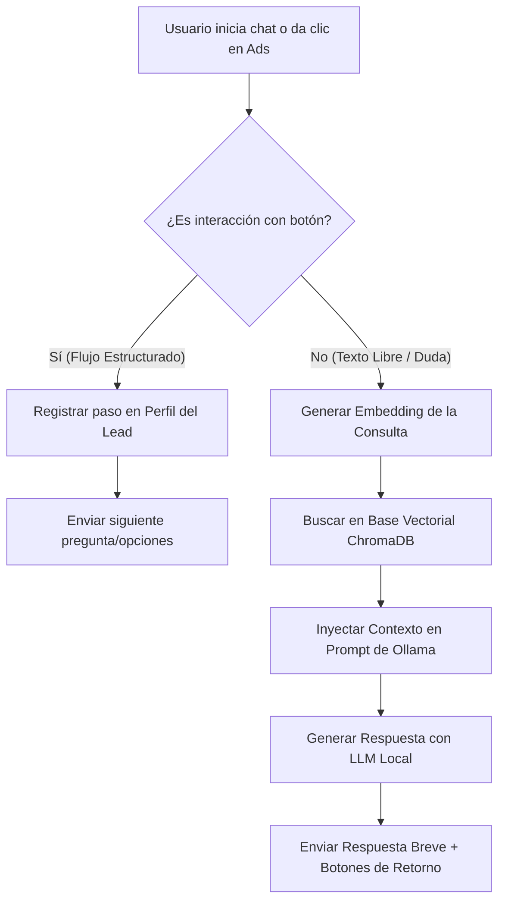

# Especificación de Caso de Uso: Agente Híbrido de Créditos (WhatsApp + RAG + Ollama)
## Contexto de Negocio (Estilo Mercado Pago / Mercado Libre)

**ID:** CU-FIN-001  
**Nombre:** Calificación Automatizada y Resolución de Dudas de Crédito en Tiempo Real  
**Actor Principal:** Usuario de la Plataforma / Propietario de Comercio  
**Sistema:** Backend de WhatsApp (Python + FastAPI) + Core RAG (ChromaDB + Ollama)  

---

## 1. Descripción del Caso de Uso
El sistema permite a un usuario final o vendedor precalificar para tres productos financieros (**Préstamo Personal**, **Express Money** y **Préstamo para Negocio**) a través de una interfaz conversacional estructurada en WhatsApp. Si el usuario interrumpe el flujo guiado con preguntas abiertas sobre términos, tasas o condiciones legales, el sistema utiliza un motor RAG con un LLM local (Ollama) para responder de forma precisa sin perder el contexto de la venta ni alucinar información financiera.

---

## 2. Diagrama de Flujo Lógico



---

## 3. Secuencia de Flujos Conversacionales

### Escenario A: Flujo guiado de Préstamo para Negocio (Conversión)
*   **Usuario:** *Selecciona botón "Préstamo para Negocio" o escribe "Quiero crédito para mi tienda"*
*   **Sistema (Botón):** "¡Gran paso! Impulsa tu comercio con financiamiento a tu medida. ¿Qué antigüedad de operación formal o informal tiene tu negocio actualmente?"
    *   *Opción 1: Menos de 1 año*
    *   *Opción 2: Entre 1 y 3 años*
    *   *Opción 3: Más de 3 años*
*   **Usuario:** *Selecciona "Entre 1 y 3 años"*
*   **Sistema (Botón):** "Perfecto, tu negocio ya tiene trayectoria. ¿Qué monto aproximado necesitas para invertir?"
    *   *Opción 1: Hasta $50,000*
    *   *Opción 2: De $50,000 a $200,000*
    *   *Opción 3: Más de $200,000*

### Escenario B: Interrupción por duda legal/térmica (Activación de RAG)
*   **Usuario (Escribe texto libre):** "¿Qué pasa si me atraso un par de días en mi mensualidad de crédito de negocio? ¿Me bloquean la cuenta de inmediato?"
*   **Sistema (Procesamiento RAG):** 
    *   *Query Vectorial:* "Atraso en mensualidad crédito negocio consecuencias bloqueo cuenta"
    *   *Contexto recuperado:* "Política General: Si un cliente se atrasa en su pago, se genera un interés moratorio del 5% sobre el saldo vencido a partir del tercer día de retraso. No se suspenden servicios adicionales antes de los 15 días de impago."
*   **Sistema (Respuesta Ollama):** "¡No te preocupes! Si llegas a tener un retraso, tienes hasta el tercer día para ponerte al corriente antes de que se genere un interés moratorio del 5% sobre el saldo vencido. Tu cuenta y operaciones seguirán activas de manera normal durante este periodo. 😊
    
    ¿Te gustaría continuar con tu solicitud de Préstamo para Negocio donde nos quedamos?"
    *   *Botón 1: Sí, continuar solicitud*
    *   *Botón 2: Hablar con un asesor 👤*

---

## 4. Reglas de Negocio y Validaciones (Políticas Core)

| ID Regla | Condición / Evento | Acción del Sistema / Restricción |
| :--- | :--- | :--- |
| **RN-01: Producto Express** | Usuario selecciona *Express Money*. | No requerir comprobantes de ingresos complejos. Solo validar INE y Cuenta CLABE. |
| **RN-02: Filtro de Ingresos**| Usuario selecciona *Préstamo Personal* pero indica "Sin ingresos comprobables". | El sistema debe ofrecer un *downgrade* amigable hacia *Express Money* en lugar de rechazar el lead. |
| **RN-03: Zero-Alucinación** | El contexto recuperado por el RAG no cuenta con la respuesta exacta. | El LLM de Ollama tiene prohibido inventar tasas. Debe disparar la plantilla de contingencia: transferencia inmediata a un asesor humano. |
| **RN-04: Ventana de 24h** | El usuario abandona el flujo a la mitad. | El backend programará un mensaje de recuperación a las 2 horas y a las 24 horas máximas según políticas de Meta. |

---

## 5. Arquitectura Técnica y Prompt Engineering

### Prompt de Sistema de Confianza (System Prompt para Ollama)
```text
Eres un asesor financiero virtual experto especializado en productos de crédito (Personal, Express y Negocio). Tu objetivo es guiar al usuario y resolver dudas con absoluta precisión.

REGLAS DE ORO:
1. Responde con un tono profesional, empático y extremadamente conciso (máximo 3 párrafos cortos, usa viñetas si es necesario).
2. Apóyate de forma estricta en el CONTEXTO RECUPERADO. Si la información no soluciona la duda del cliente, di textualmente: "Para darte el dato exacto sobre ese punto, prefiero comunicarte con uno de nuestros asesores especializados. ¿Te gustaría?".
3. Está terminantemente prohibido inventar porcentajes, penalizaciones, montos o plazos que no aparezcan de forma explícita en el contexto.

CONTEXTO:
{context}
```

---

## 6. Criterios de Aceptación (QA / Testing)
1. **Verificación de Formato:** Todas las respuestas enviadas al usuario en escenarios RAG no deben superar los 400 caracteres para garantizar legibilidad en dispositivos móviles.
2. **Prueba de Resiliencia a la Alucinación:** Al preguntar al bot por un producto inexistente (ej. *"¿Tienen crédito hipotecario para playas?"*), el sistema debe responder obligatoriamente con el mensaje de transferencia a un asesor humano.
3. **Persistencia de Flujo:** Tras responder una duda vía RAG, los botones interactivos inferiores deben forzar el retorno al último nodo del árbol estructurado en el que se encontraba el cliente.
