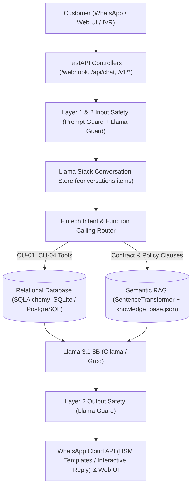

# Architecture

## Omnichannel Fintech Assistant Architecture

## Database Schema (7 Relational Entities)

1. `users`: Customer profile, normalized WhatsApp phone, RFC tax ID, credit score, account status, and WhatsApp/Voice opt-in flags.
2. `financial_products`: Catalog of credit and savings instruments (`PRESTAMO_PERSONAL`, `DINERO_EXPRESS`, `TARJETA_CREDITO`, `TARJETA_DEBITO`) with ordinary annual interest rates and average CAT.
3. `credit_accounts`: Active or pre-approved customer contracts with credit limits, available balance, retained balance, and lifecycle status (`PREAPROBADO`, `PENDIENTE_VALIDACION`, `ACTIVO`, `AL_CORRIENTE`, `ATRASADO`, `LIQUIDADO`).
4. `amortization_installments`: Scheduled installments with principal, ordinary interest, VAT (`16%`), total installment amount, due date, and payment status.
5. `transactions`: Financial ledger (`DISPERSION`, `ABONO_CUOTA`, `LIQUIDACION_ANTICIPADA`, `RENDIMIENTO_DIARIO`) with payment method (`SPEI`, `EFECTIVO_OXXO`, `INTERNO`) and bank reference.
6. `communication_logs`: Omnichannel audit trail (`WHATSAPP`, `LLAMADA_VOZ`) tracking `CU-01`..`CU-04` HSM template dispatches, encrypted PDF filenames, S3 paths, and provider tracking IDs (`wamid_*` / `call_sid_*`).
7. `rag_knowledge_chunks`: Legal and normative contract clauses indexed for semantic search.
